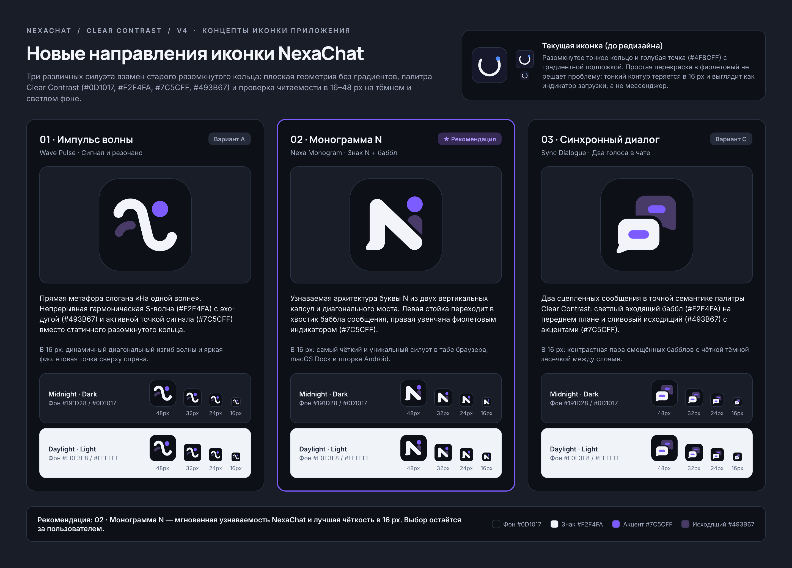

# NexaChat — Направления новой иконки приложения (Clear Contrast / v4)

Дата: 2 ноября 2026 · Статус: концепты иконки на выбор пользователя (без изменения production-ассетов).

Редактируемые фреймы в документе Pen (`/Users/rangopa/.pencil/documents/d28029f0-c5c8-47d3-a5eb-881dc5307145/untitled.pen`):
- **`09 · NexaChat / App icon directions / review`** (ID фрейма: `UFXdL`, экспорт: [`icon-concepts/pen-board/UFXdL.png`](icon-concepts/pen-board/UFXdL.png))
- **`09 · NexaChat / Icon Concepts / v4`** (ID фрейма: `JWSOR`, экспорт: [`icon-concepts/icon-concepts-board.png`](icon-concepts/icon-concepts-board.png) и [`icon-concepts/pen-board/JWSOR.png`](icon-concepts/pen-board/JWSOR.png))

---

## 1. Почему текущая иконка требует переосмысления, а не простой перекраски

Текущая иконка (`frontend/electron/build/icon.png`, `frontend/assets/icon-only.svg`, `frontend/public/favicon.svg`) построена на тонком разомкнутом белом кольце (`stroke-width: 64–80` на сетке `1024×1024`) с круглой точкой в правом верхнем секторе и градиентной подложкой (`#23233F → #121224`).

- **Потеря силуэта в малых размерах (16–24 px):** в вкладке браузера (`favicon`), системном трее и строке уведомлений тонкая дуга сливается с фоном и считывается как спиннер загрузки или кнопка питания, а не как мессенджер.
- **Отрыв от системы Clear Contrast v4:** редизайн v4 отказывается от фоновых градиентов и свечений в пользу чёткого контраста плоскостей (`#0D1017` / `#191D28`), снежно-белого акцента формы (`#F2F4FA`), чистого фиолетового действия (`#7C5CFF`) и спокойного сливового тона исходящих сообщений (`#493B67`).

---

## 2. Утверждённая палитра и геометрические принципы

Все три кандидата построены на единой сетке `1024×1024` (`rx="226"` для скруглённого квадрата иконки приложения) **без градиентов, теней, свечений и мелких деталей**:

| Роль в иконке | Токен Clear Contrast v4 | HEX | Применение |
|---|---|---|---|
| **Фон плитки (Tile Background)** | `nx-bg` (Midnight) | `#0D1017` | Глубокий нейтральный графит с максимальным контрастом для светлого знака |
| **Контекст / Поверхность (Surface)** | `nx-surface` | `#191D28` | Подложка карточек и тёмного системного окружения (Midnight) |
| **Основной знак (Primary Mark)** | `nx-text` (Dark) | `#F2F4FA` | Главный несущий силуэт иконки, считываемый боковым зрением |
| **Акцент действия / сигнала (Action Accent)** | Action Violet | `#7C5CFF` | Фокусная точка активной связи, индикатора или импульса ответа |
| **Вторичный слой / исходящий тон (Outgoing Plum)** | `nx-outgoing` (Dark) | `#493B67` | Второй план, создающий глубину без градиентов и связывающий иконку с цветом сообщений в UI |
| **Светлое окружение (Daylight Context)** | `nx-bg` / `nx-surface` (Light) | `#F0F3F8` / `#FFFFFF` | Контекст проверки контраста плитки на светлом рабочем столе и в светлой теме ОС |

---

## 3. Три концепта иконки

### Вариант 01 · Импульс волны (`Wave Pulse`) — Сигнал и резонанс
- **Векторный мастер (SVG):** [`icon-concepts/concept-01-wave-pulse.svg`](icon-concepts/concept-01-wave-pulse.svg)
- **Растровое превью (PNG 1024×1024):** [`icon-concepts/concept-01-wave-pulse.png`](icon-concepts/concept-01-wave-pulse.png)
- **Идея и характер:** Прямое визуальное воплощение слогана **«На одной волне»**. Вместо статичного разомкнутого кольца знак строится на непрерывной гармонической S-волне (`#F2F4FA`), поддержанной нижней резонансной эхо-дугой (`#493B67`) и крупной фиолетовой точкой сигнала (`#7C5CFF`) над правым изгибом.
- **Поведение в 16–48 px:** Диагональный перепад гребня и впадины в паре с крупной фиолетовой точкой сверху справа сохраняет динамику и узнаваемость даже в `16×16 px`.

### Вариант 02 · Монограмма N (`Nexa Monogram`) — Знак N + баббл сообщения ★ Рекомендация
- **Векторный мастер (SVG):** [`icon-concepts/concept-02-nexa-monogram.svg`](icon-concepts/concept-02-nexa-monogram.svg)
- **Растровое превью (PNG 1024×1024):** [`icon-concepts/concept-02-nexa-monogram.png`](icon-concepts/concept-02-nexa-monogram.png)
- **Идея и характер:** Соединяет инициал бренда **NexaChat (`N`)** с пластикой мессенджера. Левая вертикальная стойка и широкая диагональная перемычка (`#F2F4FA`) образуют цельный знак, у которого нижний левый угол мягко вытянут в хвостик сообщения. Правая стойка разделена на нижнюю опорную капсулу в цвете исходящего сообщения (`#493B67`, отделённую чёткой засечкой `#0D1017`) и верхний активный узел (`#7C5CFF`).
- **Поведение в 16–48 px:** Даёт самый плотный, контрастный и мгновенно считываемый силуэт во всех размерах (`48`, `32`, `24`, `16 px`), одинаково уверенно работает как иконка приложения в macOS Dock / Android Launcher и как крошечный `favicon` в браузере.

### Вариант 03 · Синхронный диалог (`Sync Dialogue`) — Два голоса в чате
- **Векторный мастер (SVG):** [`icon-concepts/concept-03-sync-dialogue.svg`](icon-concepts/concept-03-sync-dialogue.svg)
- **Растровое превью (PNG 1024×1024):** [`icon-concepts/concept-03-sync-dialogue.png`](icon-concepts/concept-03-sync-dialogue.png)
- **Идея и характер:** Абстрактная композиция двух сцепленных реплик, напрямую повторяющая цветовую иерархию диалога NexaChat v4. На заднем верхнем плане — сливовый баббл исходящего сообщения (`#493B67`) с фиолетовой капсулой (`#7C5CFF`), на переднем нижнем плане — контрастный светлый баббл входящего ответа (`#F2F4FA`) с ответным импульсом (`#7C5CFF`), разделённые широким контуром фона (`#0D1017`).
- **Поведение в 16–48 px:** Сразу считывается как дружелюбный личный мессенджер (без клише бумажного самолётика Telegram); широкая тёмная засечка между бабблами не даёт фигурам слипнуться в `16–24 px`.

---

## 4. Проверенные размеры и окружения

На доске `09 · NexaChat / Icon Concepts / v4` в Pen каждый из трёх концептов представлен:
1. **Крупная плитка приложения:** `168×168 px` (масштабируемый вектор с мастер-сетки `1024×1024`).
2. **Практическая шкала малых размеров:** `48 px`, `32 px`, `24 px`, `16 px`.
3. **Два контекста темы:**
   - **Midnight · Dark** (поверхность `#191D28`, фон `#0D1017`, тонкий контур `#2B3344` для отделения тёмной плитки от тёмного дока/панели).
   - **Daylight · Light** (фон `#F0F3F8` / `#FFFFFF`, высокий естественный контраст тёмной плитки `#0D1017` со светлым окружением).

---

## 5. Файлы в `design/rebrand/icon-concepts/`

| Файл | Формат и размер | Назначение |
|---|---|---|
| [`icon-concepts/concept-01-wave-pulse.svg`](icon-concepts/concept-01-wave-pulse.svg) | SVG (`1024×1024`) | Векторный мастер Концепта 01 («Импульс волны / Wave Pulse») |
| [`icon-concepts/concept-01-wave-pulse.png`](icon-concepts/concept-01-wave-pulse.png) | PNG (`1024×1024`) | Растровое превью Концепта 01 |
| [`icon-concepts/concept-02-nexa-monogram.svg`](icon-concepts/concept-02-nexa-monogram.svg) | SVG (`1024×1024`) | Векторный мастер Концепта 02 («Монограмма N / Nexa Monogram») — **Рекомендация** |
| [`icon-concepts/concept-02-nexa-monogram.png`](icon-concepts/concept-02-nexa-monogram.png) | PNG (`1024×1024`) | Растровое превью Концепта 02 |
| [`icon-concepts/concept-03-sync-dialogue.svg`](icon-concepts/concept-03-sync-dialogue.svg) | SVG (`1024×1024`) | Векторный мастер Концепта 03 («Синхронный диалог / Sync Dialogue») |
| [`icon-concepts/concept-03-sync-dialogue.png`](icon-concepts/concept-03-sync-dialogue.png) | PNG (`1024×1024`) | Растровое превью Концепта 03 |
| [`icon-concepts/icon-concepts-board.png`](icon-concepts/icon-concepts-board.png) | PNG (`2880×2066`, `@2x`) | Полный экспорт сравнительной доски `09 · NexaChat / Icon Concepts / v4` из Pen |
| [`icon-concepts/JWSOR.png`](icon-concepts/JWSOR.png) | PNG (`2880×2066`, `@2x`) | Копия экспорта доски по ID фрейма Pen (`JWSOR`) |
| [`icon-concepts/pen-board/UFXdL.png`](icon-concepts/pen-board/UFXdL.png) | PNG (`@2x`) | Экспорт обзорного фрейма `09 · NexaChat / App icon directions / review` (`UFXdL`) |
| [`icon-concepts/pen-board/JWSOR.png`](icon-concepts/pen-board/JWSOR.png) | PNG (`2880×2066`, `@2x`) | Экспорт обзорного фрейма `09 · NexaChat / Icon Concepts / v4` (`JWSOR`) |

---

## 6. Рекомендация и следующие шаги

- **Рекомендация:** **Вариант 02 · Монограмма N (`concept-02-nexa-monogram.svg`)**. Он одновременно закрепляет бренд **NexaChat**, содержит явный жест сообщения (хвостик баббла в основании стойки и фиолетовый индикатор `#7C5CFF` в правом верхнем углу) и обладает самой высокой геометрической чёткостью в `16×16 px` (`favicon.svg`) и `24×24 px`.
- Если хочется более мягкой, не-буквенной метафоры слогана «На одной волне» — подойдёт **Вариант 01 (`Wave Pulse`)**; если важнее буквальная считываемость категории «чат / переписка» — **Вариант 03 (`Sync Dialogue`)**.
- **Финальный выбор остаётся за пользователем.** После выбора одного направления следующим этапом можно сгенерировать полный пакет production-ассетов (`frontend/electron/build/icon.png`, `frontend/assets/icon-only.svg`, `frontend/public/favicon.svg`, Android adaptive launcher icons и PWA icons). В рамках текущей задачи production-файлы и код не изменялись.
