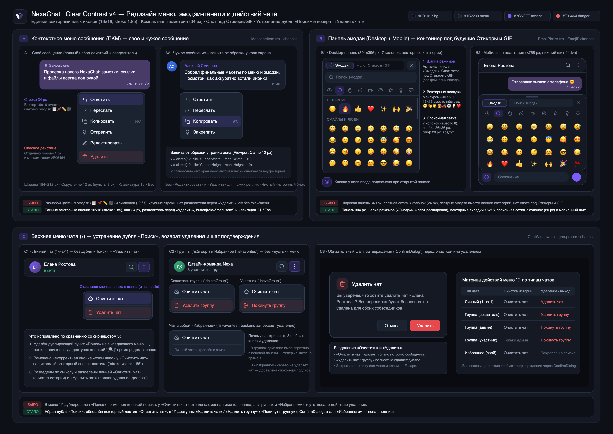

# NexaChat — Редизайн контекстного меню, эмодзи-панели и верхнего меню чата (`Clear Contrast v4`)

Дата: 2 ноября 2026 · Пакет: **Menu & Expression Picker Redesign (`Clear Contrast v4`)** · Статус: **макеты подготовлены и внедрены в React/CSS**.

Макет добавлен отдельным фреймом **`11 · NexaChat / Menus & Emoji / v4`** (ID `q0quP`) в [документ Pen](/Users/rangopa/.pencil/documents/d28029f0-c5c8-47d3-a5eb-881dc5307145/untitled.pen). [Экспорт фрейма](menu-redesign/pen-board/q0quP.png).

Сравнительная доска подготовлена в высоком разрешении (`3840×2720 px`, `@2x`) для ревью и добавления отдельным фреймом в Pen:
- **Полная обзорная доска (PNG):** [`menu-redesign/menu-redesign-board.png`](menu-redesign/menu-redesign-board.png)
- **Векторный мастер доски (SVG):** [`menu-redesign/menu-redesign-board.svg`](menu-redesign/menu-redesign-board.svg)
- **Отдельные секции (PNG):**
  - [`menu-redesign/01-message-context-menu.png`](menu-redesign/01-message-context-menu.png) — контекстное меню сообщения (ПКМ) на своём и чужом сообщении.
  - [`menu-redesign/02-emoji-picker-desktop-mobile.png`](menu-redesign/02-emoji-picker-desktop-mobile.png) — панель эмодзи (Desktop `304 px` + Mobile bottom sheet `≤768 px`) с контейнером под будущие Стикеры и GIF.
  - [`menu-redesign/03-top-overflow-delete-chat.png`](menu-redesign/03-top-overflow-delete-chat.png) — верхнее меню чата (`⋮`), устранение дубля «Поиск», возврат удаления и шаг подтверждения (`ConfirmDialog`).

---

## 1. Разбор проблем на исходных скриншотах и принятые решения

### A. Контекстное меню сообщения (ПКМ)
- **Проблема (скриншот 2):** массивное меню с крупными отступами, визуальный разнобой из системных цветных 3D-эмодзи (`📋`, `📌`, `✏️`, `🗑`) и текстовых стрелок (`↩`, `↪`), отсутствие разделителя перед разрушительным действием «Удалить», верстка на `
` без клавиатурной навигации и ролей доступности.
- **Решение:**
  1. **Единый векторный язык:** все иконки переведены на монохромные контурные SVG `16×16 px` (`stroke-width="1.85"`, `stroke-linecap="round"`, `stroke-linejoin="round"`). Также заменён цветной эмодзи `📌` в плашке «Закреплено» внутри самого сообщения на аккуратный векторный пин `12×12 px`.
  2. **Компактная геометрия `Clear Contrast v4`:** ширина меню `184–212 px`, внутренний отступ контейнера `5 px` (`border-radius: 12px`, фон `#1B2230`, рамка `1px solid #33405A`), высота строки `34 px` (`padding: 6px 10px`, `border-radius: 8px`, шрифт `13.5 px / 500`).
  3. **Группировка и сдержанный акцент удаления:**
     - На **своём сообщении** (`message-self`): `Ответить`, `Переслать`, `Копировать`, `Закрепить / Открепить`, `Редактировать`, затем тонкий разделитель `1px solid #262F42` (`.context-menu-divider`) и отделённый пункт `Удалить` (`#F06464` с мягким hover `rgba(240, 100, 100, 0.12)`).
     - На **чужом сообщении** (`message-other`): только `Ответить`, `Переслать`, `Копировать`, `Закрепить / Открепить` — без редактирования, удаления и висящего разделителя.
  4. **Защита от обрезки у краёв экрана и доступность:** координаты `x/y` ограничиваются с отступом `12 px` от границ viewport (`clamp`), меню закрывается по клику вне области, скроллу, ресайзу и клавише `Escape`, поддерживает перемещение фокуса стрелками `ArrowUp` / `ArrowDown` / `Home` / `End` (`role="menu"` + `<button type="button" role="menuitem">`).

---

### B. Панель эмодзи и контейнер будущих выражений (Desktop + Mobile)
- **Проблема (скриншот 1):** слишком широкая и шумная боковая панель (`340×420 px`), плотная сетка из 8 колонок с крупными `24 px` эмодзи, а панель категорий сверху набрана из пёстрых цветных эмодзи (`🕒 😀 👋 🐱 🍔 🚗 ⚽ 💡 ❤️`), которые спорят с самой сеткой. Отсутствует структурное место под будущие режимы Стикеров и GIF.
- **Решение:**
  1. **Архитектура контейнера выражений (`data-expression-slot="modes"`):** в верхней части панели выделена шапка `.emoji-picker__header` с переключателем режимов `.emoji-picker__modes` и кнопкой закрытия. Сейчас в ней активна пилюля **«Эмодзи»** (с контурной иконкой смайла `#7C5CFF`) — без фейковых неработающих вкладок в живом коде, но с готовой вёрсткой под добавление кнопок «Стикеры» и «GIF» в следующих релизах.
  2. **Поле поиска и векторная навигация по категориям:**
     - Компактное поле поиска (`34 px` высотой, скругление `10 px`, поверхность `#1B2230`, кнопка быстрой очистки запроса).
     - Полоса категорий переведена с цветных эмодзи на **9 монохромных контурных SVG-иконок `16×16 px`** (`Недавние` — часы, `Смайлы` — улыбка, `Жесты` — ладонь, `Природа` — лист, `Еда` — чашка, `Поездки` — компас, `Активности` — звезда, `Предметы` — лампа, `Символы` — сердце) с фиолетовым индикатором активной секции.
  3. **Снижение визуального шума и стабильный скролл:**
     - На **Desktop** панель сужена до `304×396 px`, сетка переведена на **7 колонок** (`36×36 px` ячейка, размер эмодзи `20 px`), заголовки секций сделаны компактными (`10.5 px`, uppercase).
     - Исправлен расчёт `offsetTop` при скролл-спае (`position: relative` у `.emoji-picker__scroll`) и клик по категории во время активного поискового запроса (теперь сбрасывает фильтр и плавно прокручивает к выбранной секции).
  4. **Мобильная адаптация (`≤ 768 px`):** аккуратный нижний шит (`height: min(44dvh, 340px)`) над полем ввода с удобными тач-ячейками (`38×38 px`), сохраняющий видимость переписки сверху.

---

### C. Верхнее меню чата (`⋮`), устранение дубля «Поиск» и возврат удаления
- **Проблема (скриншот 3):**
  1. В выпадающем меню `⋮` первым пунктом шёл **«Поиск»**, хотя прямо слева от кнопки `⋮` в шапке чата расположена отдельная кнопка поиска `[🔍]`.
  2. У пункта «Очистить чат» отображалась некорректная иконка «солнышка» с лучами вместо значка очистки.
  3. В меню отсутствовало действие удаления диалога — в коде `Удалить чат` рендерилось только при `!isGroup && !isFavorites`, поэтому в групповых чатах и в чате с самим собой («Избранное») пункт пропадал без альтернативы в `⋮`.
- **Решение:**
  1. **Убран дублирующий «Поиск» из меню `⋮`:** кнопка поиска `[🔍]` в шапке `.chat-header__search-btn` теперь видна на всех разрешениях (включая мобильные экраны) и подсвечивается классом `.chat-header__search-btn--active` при открытой строке поиска.
  2. **Заменена иконка «Очистить чат»:** вместо «солнышка» установлен читаемый контурный значок ластика (`16×16 px`, `stroke-width="1.85"`).
  3. **Полная матрица действий удаления/выхода в меню `⋮` без «пустых» состояний:**
     - **Личный чат (`1-на-1`):** `Очистить чат` + разделитель + **`Удалить чат`** (`deleteChat`).
     - **Групповой чат (`isGroup`) — создатель (`creator`):** `Очистить чат` + разделитель + **`Удалить группу`** (`deleteGroup`).
     - **Групповой чат (`isGroup`) — администратор (`admin`):** `Очистить чат` + разделитель + **`Покинуть группу`** (`leaveGroup`).
     - **Групповой чат (`isGroup`) — участник (`member`):** **`Покинуть группу`** (`leaveGroup`; очистка истории на бэкенде разрешена только создателю и админам). Пока список участников ещё загружается, пункт очистки не показывается до подтверждения роли.
     - **Чат с самим собой «Избранное» (`isFavorites`):** `Очистить чат` + спокойная информационная подпись `Личный чат закреплён в списке` (поскольку бэкенд `DeleteChat` в `chat_service_mutate.go` намеренно запрещает удаление `is_favorites`).
  4. **Обязательный шаг подтверждения (`ConfirmDialog`):** каждое разрушительное действие (`clear-chat`, `delete-chat`, `delete-group`, `leave-group`) открывает модальное окно подтверждения с точным описанием последствий (разделяя очистку истории сообщений и полное удаление чата/группы).

---

## 2. Сводка изменённых файлов

| Файл | Назначение изменений |
|---|---|
| [`design/rebrand/menu-redesign/menu-redesign-board.png`](menu-redesign/menu-redesign-board.png) | Сравнительная PNG-доска (`3840×2720`, `@2x`) со всеми состояниями меню A, B, C |
| [`design/rebrand/menu-redesign/menu-redesign-board.svg`](menu-redesign/menu-redesign-board.svg) | Векторный SVG-мастер сравнительной доски |
| [`design/rebrand/menu-redesign/pen-board/q0quP.png`](menu-redesign/pen-board/q0quP.png) | Экспорт нового фрейма из Pen |
| [`design/rebrand/menu-redesign/01-message-context-menu.png`](menu-redesign/01-message-context-menu.png) | Отдельный экспорт секции A (ПКМ-меню сообщения) |
| [`design/rebrand/menu-redesign/02-emoji-picker-desktop-mobile.png`](menu-redesign/02-emoji-picker-desktop-mobile.png) | Отдельный экспорт секции B (Emoji Picker Desktop + Mobile) |
| [`design/rebrand/menu-redesign/03-top-overflow-delete-chat.png`](menu-redesign/03-top-overflow-delete-chat.png) | Отдельный экспорт секции C (верхнее меню `⋮` + `ConfirmDialog`) |
| [`frontend/src/features/chats/MessageItem.tsx`](../../frontend/src/features/chats/MessageItem.tsx) | Векторные иконки `16×16` в ПКМ-меню и индикаторе закрепления, разделитель перед «Удалить», `role="menu"` / `role="menuitem"`, навигация `↑↓/Esc`, `clamp` у краёв окна |
| [`frontend/src/features/chats/EmojiPicker.tsx`](../../frontend/src/features/chats/EmojiPicker.tsx) | Шапка `.emoji-picker__header` со слотом режимов (`Эмодзи`), монохромные SVG-иконки 9 категорий (`CategoryIcon`), исправление навигации по категориям при поиске |
| [`frontend/src/features/chats/EmojiPicker.css`](../../frontend/src/features/chats/EmojiPicker.css) | Геометрия панели `304×396 px`, 7-колоночная сетка `36×36 px` (`20 px` глифы), стили шапки, поиска, вкладок и мобильного нижнего шита (`44dvh`) |
| [`frontend/src/features/chats/ChatWindow.tsx`](../../frontend/src/features/chats/ChatWindow.tsx) | Удаление дубля «Поиск» из `⋮`, векторная иконка «Очистить чат», подключение `deleteGroup` / `leaveGroup` с `ConfirmDialog`, подпись для `isFavorites`, закрытие по `Escape` |
| [`frontend/src/styles/chat.css`](../../frontend/src/styles/chat.css) | Компактные стили `.context-menu`, `.context-menu-item`, `.context-menu-divider`, активные состояния кнопок шапки и видимость кнопки поиска на мобильных экранах |
| [`frontend/src/styles/groups.css`](../../frontend/src/styles/groups.css) | Выравнивание геометрии `.chat-menu__dropdown`, `.chat-menu__item` (`34 px`, `border-radius: 8px`), `.chat-menu__divider` и `.chat-menu__note` |

## 3. Проверки

Gemini 4 Argon сообщил об успешных `npm run lint`, `npm run build` и 61 unit-тесте. После проверки прав доступа к очистке групп координатор повторно выполнил `npm run build` — сборка прошла. Доска проверена визуально и экспортирована из Pen; отдельный снимок работающего приложения в этой итерации не сделан.

Также пересобран локальный macOS arm64 пакет [`NexaChat-1.5.5-mac-arm64.dmg`](../../frontend/electron/release/NexaChat-1.5.5-mac-arm64.dmg) командой `npm run dist:desktop`; `codesign --verify --deep --strict` прошёл. SHA-256: `6a33accf41bb1f206c586653512a522188d64e55296918490e8f3882e8e01a16`. Подпись локальная, без Developer ID.
