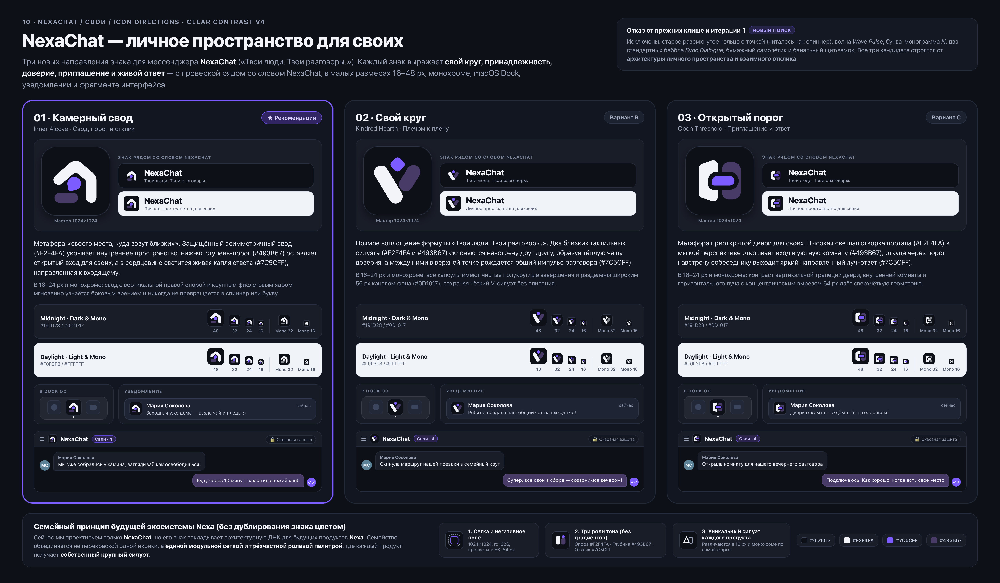

# NexaChat — Новые направления иконки («Личное пространство для своих»)

Дата: 2 ноября 2026 · Итерация 2 (`Clear Contrast v4`) · Статус: **пользователь выбрал Вариант 02 «Свой круг»**; он внедрён в production-ассеты NexaChat. Сравнительная доска ниже сохраняет исходный этап поиска и прежнюю рекомендацию Варианта 01 как историю итерации.

Доска также добавлена отдельным фреймом **`10 · NexaChat / Свои / Icon directions`** (ID `iiBVQ`) в существующий документ [Pen](/Users/rangopa/.pencil/documents/d28029f0-c5c8-47d3-a5eb-881dc5307145/untitled.pen). Экспорт фрейма: [PNG](own-space-icons/pen-board/iiBVQ.png). Векторные мастера каждого знака находятся в папке ниже.

---

## 1. Контекст и отказ от прежних решений

Имя продукта — строго **NexaChat** (первый самостоятельный мессенджер будущей многопродуктовой экосистемы **Nexa**).
Позиционирование: **«NexaChat — личное пространство для своих»**, короткая формула — **«Твои люди. Твои разговоры.»**

По итогам ревью первой итерации (`design/rebrand/icon-concepts/`) и старого знака полностью исключены:
- **Старое разомкнутое кольцо с отдельной точкой** — в `16–24 px` теряет форму и считывается как системный спиннер загрузки или кнопка питания.
- **Волна (`Wave Pulse`)**, **буквенная монограмма (`N`)** и **два стандартных баббла (`Sync Dialogue`)** — отклонены пользователем как не передающие ощущение своего круга и камерного пространства.
- **Категорийные штампы** — бумажный самолётик (Telegram), щит/замок и холодный корпоративный символизм.

Все три новых направления построены на утверждённой палитре **Clear Contrast v4** без градиентов и свечений:
- Фон плитки (`nx-bg` Midnight): `#0D1017` (`1024×1024`, `rx="226"`).
- Главный несущий силуэт (`nx-text` Dark): `#F2F4FA`.
- Второй пространственный план / порог / плечо (`nx-outgoing` Dark): `#493B67`.
- Смысловой акцент живого отклика (`Action Violet`): `#7C5CFF` (ровно один фокусный элемент в каждом знаке).

---

## 2. Три новых направления знака

### Вариант 01 · Камерный свод (`Inner Alcove`) — Свод, порог и отклик ★ Рекомендация
- **Векторный мастер (SVG):** [`own-space-icons/concept-01-inner-alcove.svg`](own-space-icons/concept-01-inner-alcove.svg)
- **Растровый мастер (PNG 1024×1024):** [`own-space-icons/concept-01-inner-alcove.png`](own-space-icons/concept-01-inner-alcove.png)
- **Монохромная версия (SVG / PNG):** [`own-space-icons/concept-01-inner-alcove-mono.svg`](own-space-icons/concept-01-inner-alcove-mono.svg) · [`own-space-icons/concept-01-inner-alcove-mono.png`](own-space-icons/concept-01-inner-alcove-mono.png)
- **Малые размеры (PNG):** [`16 px`](own-space-icons/sizes/concept-01-inner-alcove-16.png) · [`24 px`](own-space-icons/sizes/concept-01-inner-alcove-24.png) · [`32 px`](own-space-icons/sizes/concept-01-inner-alcove-32.png) · [`48 px`](own-space-icons/sizes/concept-01-inner-alcove-48.png)
- **Идея и пластика:** Архитектурная метафора «своего места, куда зовут близких». Защищённый асимметричный свод (`#F2F4FA`) с мягким коньком крыши и правой вертикальной опорой обнимает внутреннее пространство. Снизу слева расположена скруглённая ступень-порог (`#493B67`), оставляющая открытый приветственный вход. Внутри свода парит направленная капля живого ответа (`#7C5CFF`), развёрнутая носиком к входящему («тебя ждут, тебе отвечают»).
- **Поведение в 16–48 px, монохроме и интерфейсе:** Широкие просветы (`≥ 64 px` на сетке `1024`) между сводом, порогом и центральным откликом исключают слипание пикселей даже в `16×16 px`. В паре со словом **NexaChat**, в macOS Dock и шторке уведомлений знак мгновенно создаёт ощущение уюта, защищённости и личного контакта без единого клише замка или баббла.
- **Ограничения и компромиссы:** Асимметричная композиция (открытый вход слева, вертикальная стена справа) требует сохранения ориентации — знак нельзя зеркалить в RTL-интерфейсах.

---

### Вариант 02 · Свой круг (`Kindred Hearth`) — Плечом к плечу
- **Векторный мастер (SVG):** [`own-space-icons/concept-02-kindred-hearth.svg`](own-space-icons/concept-02-kindred-hearth.svg)
- **Растровый мастер (PNG 1024×1024):** [`own-space-icons/concept-02-kindred-hearth.png`](own-space-icons/concept-02-kindred-hearth.png)
- **Монохромная версия (SVG / PNG):** [`own-space-icons/concept-02-kindred-hearth-mono.svg`](own-space-icons/concept-02-kindred-hearth-mono.svg) · [`own-space-icons/concept-02-kindred-hearth-mono.png`](own-space-icons/concept-02-kindred-hearth-mono.png)
- **Малые размеры (PNG):** [`16 px`](own-space-icons/sizes/concept-02-kindred-hearth-16.png) · [`24 px`](own-space-icons/sizes/concept-02-kindred-hearth-24.png) · [`32 px`](own-space-icons/sizes/concept-02-kindred-hearth-32.png) · [`48 px`](own-space-icons/sizes/concept-02-kindred-hearth-48.png)
- **Идея и пластика:** Прямое визуальное воплощение формулы **«Твои люди. Твои разговоры.»** Два тактильных наклонных силуэта — ведущее светлое крыло (`#F2F4FA`) и парное сливовое крыло (`#493B67`) — склоняются навстречу друг другу, образуя тёплую V-образную чашу доверия («свои рядом, плечом к плечу»). В верхней колыбели между ними рождается живая искра общего разговора (`#7C5CFF` — мягкий скруглённый ромб).
- **Поведение в 16–48 px, монохроме и интерфейсе:** Все три элемента имеют чистые скруглённые контуры без острых засечек и разделены сквозным каналом фона (`56 px`). В `16–24 px` и монохроме силуэт считывается как дружелюбный, человечный жест близости и диалога.
- **Ограничения и компромиссы:** Из трёх вариантов этот знак самый мягкий и эмоциональный («про людей»), но менее «архитектурный» (меньше подчёркивает тему защищённого приватного помещения, чем Варианты 01 и 03).

---

### Вариант 03 · Открытый порог (`Open Threshold`) — Приглашение и ответ
- **Векторный мастер (SVG):** [`own-space-icons/concept-03-open-threshold.svg`](own-space-icons/concept-03-open-threshold.svg)
- **Растровый мастер (PNG 1024×1024):** [`own-space-icons/concept-03-open-threshold.png`](own-space-icons/concept-03-open-threshold.png)
- **Монохромная версия (SVG / PNG):** [`own-space-icons/concept-03-open-threshold-mono.svg`](own-space-icons/concept-03-open-threshold-mono.svg) · [`own-space-icons/concept-03-open-threshold-mono.png`](own-space-icons/concept-03-open-threshold-mono.png)
- **Малые размеры (PNG):** [`16 px`](own-space-icons/sizes/concept-03-open-threshold-16.png) · [`24 px`](own-space-icons/sizes/concept-03-open-threshold-24.png) · [`32 px`](own-space-icons/sizes/concept-03-open-threshold-32.png) · [`48 px`](own-space-icons/sizes/concept-03-open-threshold-48.png)
- **Идея и пластика:** Метафора приоткрытой двери в комнату для своих. Слева — высокая светлая створка портала (`#F2F4FA`) в мягкой фронтальной перспективе; справа — тёплая внутренняя комната (`#493B67`). Из глубины комнаты через порог навстречу собеседнику выходит яркий горизонтальный луч-ответ (`#7C5CFF` с направленным уголком реплики слева внизу), окружённый равномерным концентрическим каналом фона (`64 px`).
- **Поведение в 16–48 px, монохроме и интерфейсе:** Перпендикулярное пересечение вертикальных плоскостей портала и горизонтальной капсулы ответа даёт максимальную геометрическую резкость на пиксельной сетке `16×16` и `24×24 px`. Отлично рифмуется с прямоугольно-скруглённой архитектурой карточек и бабблов **Clear Contrast v4**.
- **Ограничения и компромиссы:** Более строгий, конструктивный и модернистский характер по сравнению с камерной пластикой Варианта 01 и мягкостью Варианта 02.

---

## 3. Семейный принцип будущей экосистемы Nexa

Сейчас проектируется только мессенджер **NexaChat**, однако выбранная система закладывает правила для будущей семьи приложений **Nexa** без проектирования их логотипов заранее и без банальной перекраски одного знака:

1. **Единая конструктивная сетка:** базовая плитка `1024×1024 px` (`rx="226"`), оптическое поле знака `180..844 px`, минимальная толщина несущего элемента `140–156 px`, минимальный негативный просвет между деталями `56–64 px` (гарантия читаемости в `16 px` и монохроме).
2. **Трёхчастная тональная иерархия Clear Contrast:**
   - **Несущая форма (`#F2F4FA`, ~55–60% площади)** — задаёт главный уникальный силуэт приложения.
   - **Пространственный план (`#493B67`, ~25% площади)** — формирует глубину и контекст среды без использования градиентов.
   - **Фокус отклика (`#7C5CFF`, ~15% площади, строго 1 элемент)** — обозначает живое действие, отклик или точку внимания.
3. **Запрет на цветовую копию:** каждый будущий продукт **Nexa** обязан иметь **собственный крупный внешний силуэт** (чтобы иконки безошибочно различались боковым зрением в Dock и в одноцветном системном трее), наследуя при этом радиусы скруглений, толщину форм и ролевую палитру.

---

## 4. Сводная таблица файлов (`design/rebrand/own-space-icons/`)

| Файл | Формат и размер | Назначение |
|---|---|---|
| [`own-space-icons/own-space-icons-board.png`](own-space-icons/own-space-icons-board.png) | PNG (`5760×3360`, `@2x`) | Полная сравнительная доска `10 · NexaChat / Свои / Icon directions` (плитки, лок-апы `NexaChat`, 16–48 px, монохром, Dock, уведомления, UI-фрагмент, семейный принцип Nexa) |
| [`own-space-icons/pen-board/iiBVQ.png`](own-space-icons/pen-board/iiBVQ.png) | PNG (`2880×1680`) | Экспорт нового фрейма из Pen |
| [`own-space-icons/concept-01-inner-alcove.svg`](own-space-icons/concept-01-inner-alcove.svg) | SVG (`1024×1024`) | Векторный мастер Варианта 01 («Камерный свод / Inner Alcove») — **Рекомендация** |
| [`own-space-icons/concept-01-inner-alcove.png`](own-space-icons/concept-01-inner-alcove.png) | PNG (`1024×1024`) | Растровый мастер Варианта 01 |
| [`own-space-icons/concept-01-inner-alcove-mono.svg`](own-space-icons/concept-01-inner-alcove-mono.svg) | SVG (`1024×1024`) | Монохромный векторный мастер Варианта 01 |
| [`own-space-icons/concept-01-inner-alcove-mono.png`](own-space-icons/concept-01-inner-alcove-mono.png) | PNG (`1024×1024`) | Монохромное превью Варианта 01 |
| [`own-space-icons/concept-02-kindred-hearth.svg`](own-space-icons/concept-02-kindred-hearth.svg) | SVG (`1024×1024`) | Векторный мастер Варианта 02 («Свой круг / Kindred Hearth») |
| [`own-space-icons/concept-02-kindred-hearth.png`](own-space-icons/concept-02-kindred-hearth.png) | PNG (`1024×1024`) | Растровый мастер Варианта 02 |
| [`own-space-icons/concept-02-kindred-hearth-mono.svg`](own-space-icons/concept-02-kindred-hearth-mono.svg) | SVG (`1024×1024`) | Монохромный векторный мастер Варианта 02 |
| [`own-space-icons/concept-02-kindred-hearth-mono.png`](own-space-icons/concept-02-kindred-hearth-mono.png) | PNG (`1024×1024`) | Монохромное превью Варианта 02 |
| [`own-space-icons/concept-03-open-threshold.svg`](own-space-icons/concept-03-open-threshold.svg) | SVG (`1024×1024`) | Векторный мастер Варианта 03 («Открытый порог / Open Threshold») |
| [`own-space-icons/concept-03-open-threshold.png`](own-space-icons/concept-03-open-threshold.png) | PNG (`1024×1024`) | Растровый мастер Варианта 03 |
| [`own-space-icons/concept-03-open-threshold-mono.svg`](own-space-icons/concept-03-open-threshold-mono.svg) | SVG (`1024×1024`) | Монохромный векторный мастер Варианта 03 |
| [`own-space-icons/concept-03-open-threshold-mono.png`](own-space-icons/concept-03-open-threshold-mono.png) | PNG (`1024×1024`) | Монохромное превью Варианта 03 |
| [`own-space-icons/sizes/`](own-space-icons/sizes/) | PNG (`16, 24, 32, 48 px`) | Индивидуальные проверочные экспорты малых размеров для всех трёх концептов |

---

## 5. Рекомендация

**Решение пользователя от 2 ноября 2026:** принят **Вариант 02 · «Свой круг»**. Вариант 01 отклонён как похожий на приложение для управления домом, Вариант 03 отклонён. Текущий пакет внедрения описан в [`ops/ICON-IMPLEMENTATION.md`](../../ops/ICON-IMPLEMENTATION.md).

- **Основная рекомендация — Вариант 01 · Камерный свод (`concept-01-inner-alcove.svg`)**: он наиболее точно и самобытно соединяет обе части позиционирования — **«личное пространство для своих»** (уютный свод и приглашающий порог) и **«живой разговор»** (направленная капля ответа внутри свода). У него самый запоминающийся, не-шаблонный контур, который невозможно спутать с другими мессенджерами.
- **Если важнее образ близких людей («Твои люди»)** — стоит выбрать **Вариант 02 · Свой круг (`concept-02-kindred-hearth.svg`)**.
- **Если ближе строгая архитектурная метафора приглашения («вход для своих»)** — подойдёт **Вариант 03 · Открытый порог (`concept-03-open-threshold.svg`)**.
