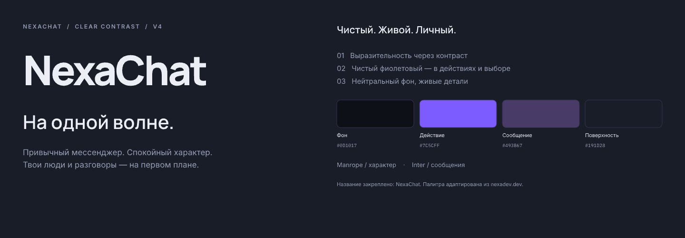
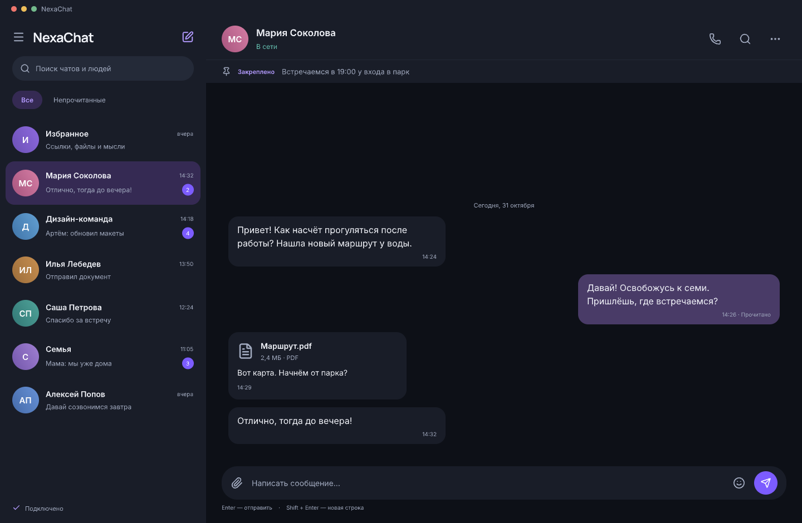
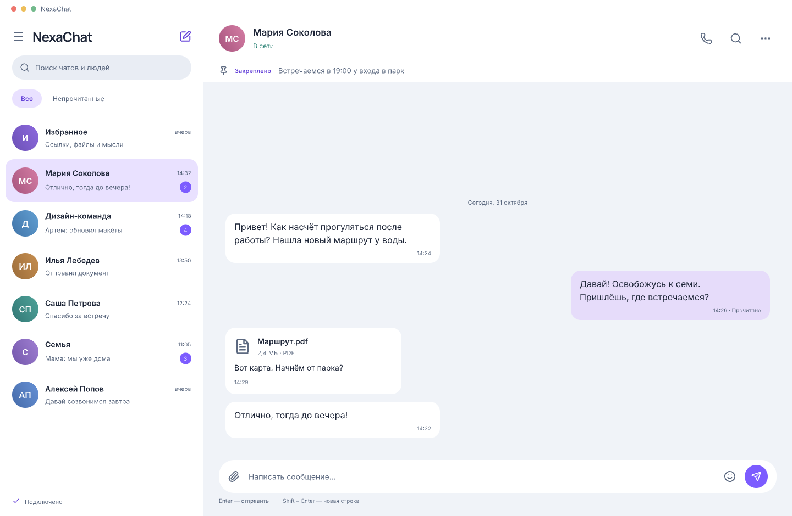
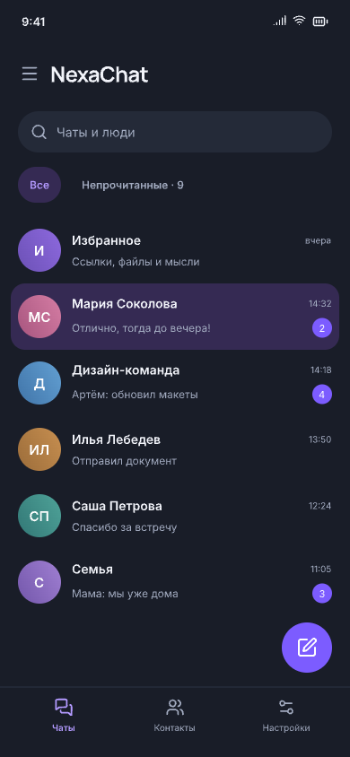
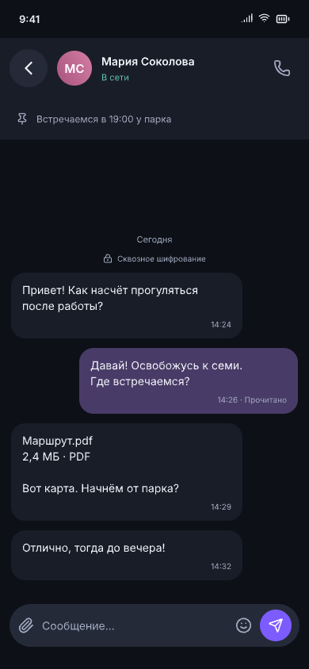
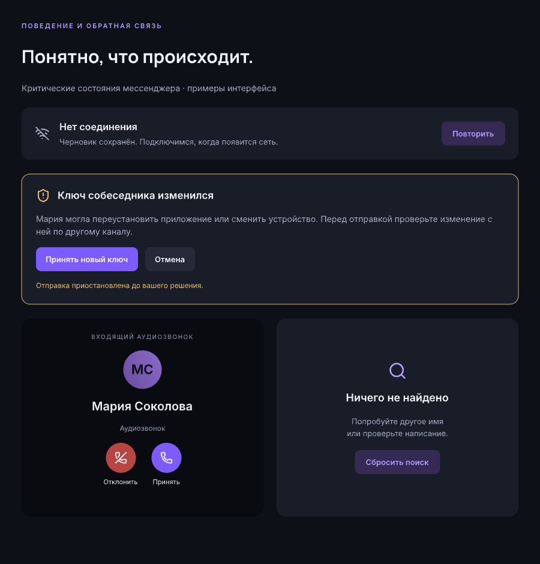
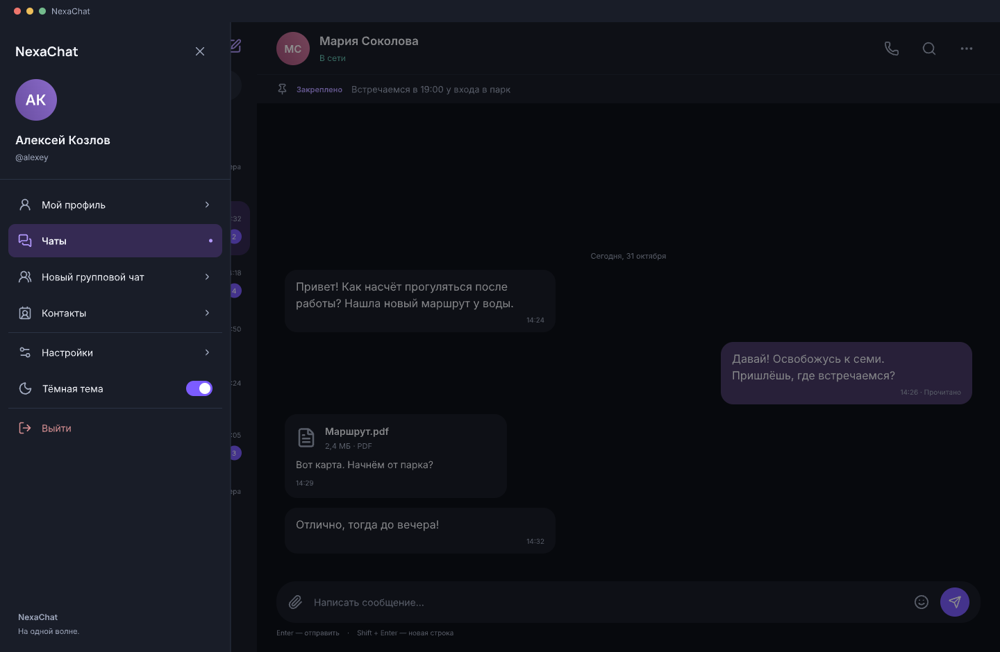
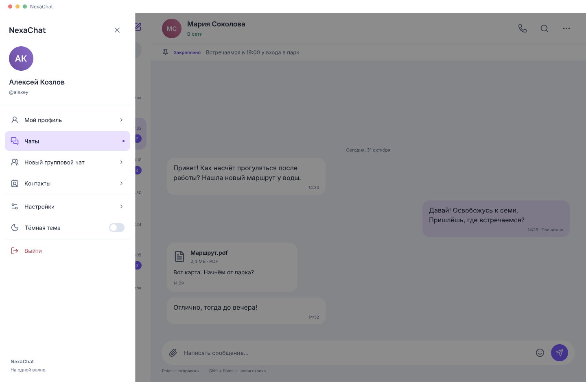
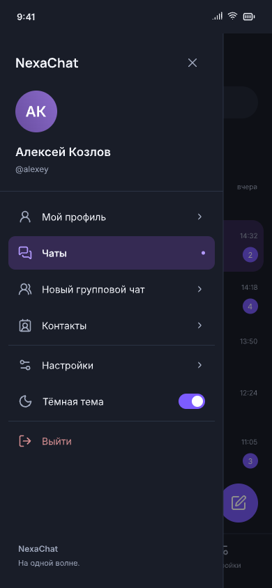

# NexaChat — обновлённый дизайн

31 октября 2026 · Версия 4 · Дизайн на согласование

[Тикет #1, привязанный к Orca](https://github.com/Appjey/NexaChat/issues/1) · Рабочая область `nexa-rebrand-design`, статус `in-review`.

Название остаётся **NexaChat**. В версии 4 живость возвращена через контраст: более ясное разделение фона и поверхностей, чистый фиолетовый в кнопках и счётчиках, цветные аватары и более выразительные исходящие сообщения. Нейтральный фон без свечения удерживает баланс. Палитра [лендинга](https://nexadev.dev/) сохраняется в небольших акцентах; большие поверхности не заливаются ярким цветом.

[Полная задача и критерии приёмки](TICKET.md) · [Отдельная оценка нативных клиентов](PLATFORM-DECISION.md)

[Открыть редактируемый документ pen.dev](/Users/rangopa/.pencil/documents/d28029f0-c5c8-47d3-a5eb-881dc5307145/untitled.pen)

В документе девять фреймов, включая раскрытое боковое меню desktop light/dark и mobile; все элементы интерфейса — редактируемые слои. Имена и переписка демонстрационные. Это визуальная концепция, не интерактивный прототип. Остальные экраны, production-иконки и полная компонентная библиотека описаны как следующий этап в задаче.

## Направление бренда

## Desktop — Midnight, основная тема

Две колонки без постоянной тяжёлой боковой панели. Фон нейтральный, исходящие сообщения насыщеннее фона, цвет сосредоточен на выборе чата и основных действиях. Меню открывается по кнопке слева от NexaChat.

## Desktop — Daylight

Светлая версия с мягкими сиреневыми исходящими сообщениями, цветными аватарами и той же иерархией. Предупреждения имеют отдельный цвет и текст.

## Mobile — список и диалог

Кнопка создания чата закреплена отдельным слоем поверх списка справа внизу, над нижней навигацией. Чаты прокручиваются под ней, кнопка остаётся на месте и не входит в содержимое списка. Возврат из диалога — отдельная кнопка 48×48 с более крупной стрелкой и отступом от аватара, чтобы не попадать в профиль.

Одна основная поверхность на экране. Нижняя навигация в списке; в диалоге остаются back, звонок, закреп и ввод сообщения. Safe areas и клавиатуру предстоит проверить на реализации.

## Состояния

Потеря сети сохраняет черновик. Смена ключа требует явного решения. Звонок и пустой поиск имеют понятные действия. Цвет дополняет описание состояния.

## Раскрытое боковое меню

Профиль, чаты, создание группы, контакты, настройки, тема и выход — по существующим функциям NexaChat. Текущий раздел выделен; фон затемнён. Закрытие крестиком, по фону, Escape или Android Back; выход — через подтверждение. Детальное поведение описано в задаче.

## Отдельные нативные клиенты

Моя рекомендация — **сохранить общую React-базу, доработать Capacitor/Electron и нативные интеграции**, а переписывание UI рассматривать после замеров. В текущей ветке подтверждены Android и macOS arm64; готовность iOS/Windows/Linux не установлена. Для iOS-звонков понадобится отдельная проверка PushKit/CallKit; это не равнозначно обязательному переписыванию всего клиента.

В [архитектурной записке](PLATFORM-DECISION.md) — варианты по ОС, компромиссы, предлагаемые бюджеты и условия, при которых native spike будет оправдан. Это оценка по исходникам и официальной документации; замеры текущей сборки не проводились.

Для ревью: подходит ли баланс контраста и цвета, удобна ли плотность и состав меню. Название NexaChat уже закреплено. Реализация начнётся отдельным этапом после обсуждения.
